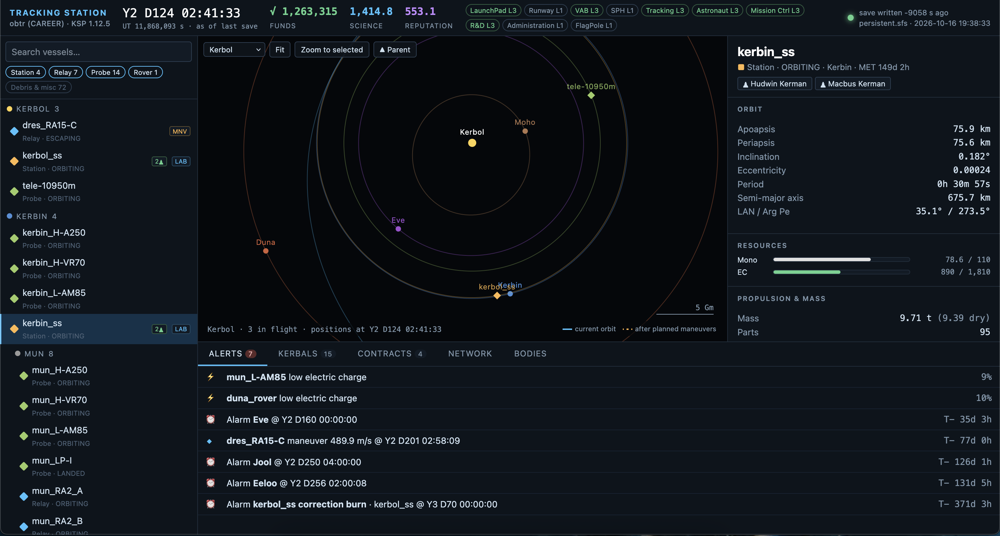

# KSP Tracking Station

A second-monitor companion for **Kerbal Space Program 1.12** career games.

**Live demo:** https://obuter.com/ksp_tracking-station/



- **`tools/ksp_digest.py`** reads your `.sfs` save, which can run to hundreds of thousands of lines, and writes a compact digest: career, facilities, kerbals (estimated XP), every vessel's orbit, resources, Δv, antennas, planned maneuver nodes (with the predicted orbit after each burn), alarms and contracts.
- **`web/dashboard.html`** is a live "tracking station" page with:
  - a vessel list and an orbit map (planned burns drawn dashed)
  - vessel details and alerts (upcoming or missed burns, low EC/fuel, deadlines, alarms)
  - kerbals, contracts, and relay-network status

Pure Python standard library and a single HTML file. No installs, no internet.

## Usage

**1. Get it** (once):

```bash
git clone https://github.com/obuter/ksp_tracking-station.git
cd ksp_tracking-station
```

**2. Run it** (every time you play, from the repo folder):

```bash
python3 tools/ksp_digest.py --serve
```

**3. Open the dashboard:** **http://localhost:8765/web/dashboard.html**, and play. The script watches your live save and regenerates whenever KSP writes it: quicksave (F5), scene changes and autosave. The page picks the change up within about 5 s.

Other modes:

```bash
python3 tools/ksp_digest.py                # one-shot digest → data/digest.md, .json, .js
python3 tools/ksp_digest.py --save my.sfs  # a specific save (or drop .sfs snapshots into saves/)
python3 tools/ksp_digest.py --all          # include debris, flags, asteroids, deployed science
python3 tools/ksp_digest.py --watch        # regenerate on save changes, no web server
```

### Finding your save

By default the script uses the most recently written `saves/*/persistent.sfs` in the macOS Steam install. Override it with:

```bash
export KSP_DIR="/path/to/Kerbal Space Program"        # KSP install folder
export KSP_SAVE="/path/to/saves/mycareer/persistent.sfs"  # or an exact save file
```

The script only **reads** the save. It never writes to the KSP folder.

## Repo layout

| Path | What |
|---|---|
| `tools/ksp_digest.py` | save parser and digest writer, `--watch` / `--serve` |
| `web/dashboard.html` | dashboard; reads `data/digest.js` |
| `docs/DSN_CheatSheet.md` | stock CommNet network design: antenna ranges, relay rings, ring deployment |
| `notes/campaign.template.md` | template for a short living campaign plan |
| `CLAUDE.md`, `.claude/skills/` | instructions for Claude Code: a dev skill for the tools, a play skill for in-game help |
| `data/`, `saves/`, `scratch/` | generated / personal (gitignored) |

## Notes and limitations

- Kerbal XP is estimated from flight logs.
- Δv is a vacuum estimate per stage: each stage burns the fuel in the parts it drops (no fuel-line rules; solid boosters ignored).
- Maneuvers that cross into another body's SOI are not predicted yet.
- Positions and countdowns are as of the last save, not the live game clock.

## License

MIT
